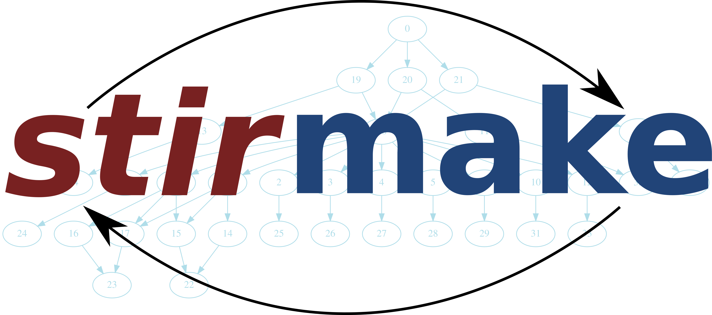

# Stirmake



Stirmake is a rewrite of the venerable make. It is intended to make build
systems easy to understand and maintain for mere mortals. At the same time, it
is intended to once and for all eliminate the need for frequent `make clean`.

To understand the motivation behind stirmake, one needs to first understand why
recursive make is harmful[1]. Then one needs to attempt to create a
non-recursive build system using make[2], finding it's very hard to do so, and
the result is an almost unmaintainable mess. One also could explore the
alternatives for make such as Makefile autogenerators (hint: a chain is as
strong as its weakest link, and a weak, not necessarily the weakest, link is
make), and standalone alternatives. The standalone alternatives include SCons,
Rake and Shake of which SCons and Rake are implemented in a slow interpreted
language, and Shake uses a strange Haskell-based input syntax.

## User's guide

The user's guide of stirmake is available at
https://jmtilli.github.io/stirmakeguide

## Feature set

* Fast C implementation, with performance comparable to make
* Intuitive syntax, similar to make
* Support for parallelism
* Support for including sub-Stirfiles in subdirectories
* Support for including Stirfiles past project boundaries, controlling what is visible to subprojects
* Executes shell commands in subdirectories, like recursive make and unlike inclusive whole-project make
* Proper data types; finally, filenames can have spaces
* Programmablity with a custom language
* Prevention of running two simultaneous instances for same project hierarchy
* TODO: LuaJIT integration
* Multiple targets per rules
* Dependency on a whole directory hierarchy, using its latest mtime
* Compatibility with `gcc -M` format dependency files
* Conditional compilation
* Build command, timestamp and file size database, with dependency on build command and file information
* Automatically deduced cleaning rules
* Fast bytecode based variable expansion
* Many sanity checks; some fatal errors, some helpful suggestions
* Support for invoking build tool in any directory, much like you can invoke git in any directory and it automatically detects where the `.git` top-level repository is located
* Full GNU make jobserver integration, allowing parallel sub-makes
* Modification of dependencies on the fly, so that the built system can affect the build system

## Installing pre-build stirmake on Linux

Currently, there are pre-built binary packages for several architectures. How
to install stirmake on RPM-based system:

AMD64:

```
sudo rpm -i https://github.com/Aalto5G/stirmake/releases/download/v0.4.4/stirmake-0.4.4-1.x86_64.rpm
```

ARM64:

```
sudo rpm -i https://github.com/Aalto5G/stirmake/releases/download/v0.4.4/stirmake-0.4.4-1.aarch64.rpm
```

ARM32:

```
sudo rpm -i https://github.com/Aalto5G/stirmake/releases/download/v0.4.4/stirmake-0.4.4-1.armv7hl.rpm
```

i386:

```
sudo rpm -i https://github.com/Aalto5G/stirmake/releases/download/v0.4.4/stirmake-0.4.4-1.i686.rpm
```

On a DEB-based system:

AMD64:

```
curl -Lo sm.deb https://github.com/Aalto5G/stirmake/releases/download/v0.4.4/stirmake_0.4.4_amd64.deb
sudo dpkg -i sm.deb
```

ARM64:

```
curl -Lo sm.deb https://github.com/Aalto5G/stirmake/releases/download/v0.4.4/stirmake_0.4.4_arm64.deb
sudo dpkg -i sm.deb
```

ARM32:

```
curl -Lo sm.deb https://github.com/Aalto5G/stirmake/releases/download/v0.4.4/stirmake_0.4.4_armhf.deb
sudo dpkg -i sm.deb
```

i386:

```
curl -Lo sm.deb https://github.com/Aalto5G/stirmake/releases/download/v0.4.4/stirmake_0.4.4_i386.deb
sudo dpkg -i sm.deb
```

## Building stirmake

In order to build stirmake, you need to install development tools, git, flex
and byacc. Depending on the Linux distribution, that can be:

```
sudo apt install git build-essential
sudo apt install flex byacc
```

Or:

```
sudo yum groupinstall 'Development Tools'
sudo yum install git flex byacc
```

If you use cygwin, install flex and byacc but also install m4, because flex
requires it and selecting flex does not automatically select m4. Also gcc and
binutils are required.

A release version can be built without git, flex and byacc. How to download a
release:

```
curl -Lo sm.tgz https://github.com/Aalto5G/stirmake/releases/download/v0.4.4/stirmake-v0.4.4.tar.gz
tar xzvf sm.tgz
cd stirmake-v0.4.4
```

Stirmake is built in the following way using GNU make to bootstrap it (omit git
commands if building a released version):

```
git submodule init
git submodule update
cd stirc
make
```

Or if GNU make is not available, shell can be used to bootstrap it (omit git
commands if building a released version):

```
git submodule init
git submodule update
cd stirc
./bootstrapnomake.sh
```

The compiled stirmake executable is fully self-contained. No dynamic libraries
are required apart from the ones that come with the operating system.

Note there is no make install. One needs to use the install.sh script:

```
cd stirc
sudo ./install.sh /usr/local
sudo mandb
```

It's also possible to install without root permissions locally:

```
cd stirc
./install.sh
```

...which installs it to `~/.local`. If the directory `~/.local` does not exist,
it needs to be created with `mkdir`. Note that in some cases, when installing
to `~/.local`, the `~/.local/bin` might not exist (it is automatically created
then). If the directory `~/.local/bin` needed to be created, it might be
necessary to log out of the Linux system and log in again. In graphical logins,
closing the terminal may not be enough. If this is not done, the `PATH`
environment value might not contain the needed directories. Most modern Linux
systems place it into `PATH` if it exists. Note also that `~/.local` is a
modern Linux-ism, so on BSDs, MacOS or Cygwin it might not do what you want,
and the same is true for older versions of Linux as well. Generally, in these
cases, installing to /usr/local should work.

## Data model

Bad programmers start from algorithms. Good programmers start from data
structures. "Show me your flowchart and conceal your tables, and I shall
continue to be mystified. Show me your tables, and I won't usually need your
flowchart; it'll be obvious." An example of a tool created by a good programmer
is Git, where the data model supports merges, being superior to CVS that does
not.

Stirmake aims to have good data structures from day one. Specifically:

* Variables have proper data types; the data model is very similar to JSON
* There is recursive nested scoping; variables in sub-Stirfiles affect only sub-sub-Stirfiles included in the sub-Stirfiles, but not the main-Stirfile
* Delayed evaluation is created using functions
* Rules have 1..N targets and 0..M dependencies
* Each rule has 0..K commands to execute, with executed commands stored to database

As example of true data typing, see:

```
$SRC = ["foo.c", "bar.c", "baz.c"]
```

As example of delayed evaluation:

```
$CCCMD<> = ["cc", "-Wall", "-c", $<]
```

where the marker `<>` means create a function from the expression.

As example of nested scoping:

```
@beginholeyscope
  $CCCMD = @LP $CCCMD
  @projdirinclude "subproject"
@endscope
```

Now `$CCCMD` is visible to the subproject but `$SRC` is not. The `@LP` means
access lexical parent scope.

As example of rules, a Makefile is incapable of representing the following
Stirfile because the rule has 2 targets:

```
stiryy.tab.c stiryy.tab.h: stiryy.y
        byacc -d -p stiryy -o stiryy.tab.c stiryy.y
```

The best we can do with make is the following (ugh):

```
stiryy.tab.c: stiryy.y Makefile
        byacc -d -p stiryy -o .tmpc.stiryy.tab.c stiryy.y
        rm .tmpc.stiryy.tab.h
        mv .tmpc.stiryy.tab.c stiryy.tab.c
stiryy.tab.h: stiryy.y Makefile
        byacc -d -p stiryy -o .tmph.stiryy.tab.c stiryy.y
        rm .tmph.stiryy.tab.c
        mv .tmph.stiryy.tab.h stiryy.tab.h
```

Further minor details of the data model:

* Dependency can be: (i) normal, (ii) recursive, (iii) order-only
* Rule can be: (a) normal, (b) recursive target rule, (c) phony, (d) maybe-rule, (e) dist-rule

Recursive dependencies depend on the latest mtime within an entire hierarchy.
Order-only dependencies are executed only if the file/directory does not exist,
and a changed mtime does not cause execution of the rule.

Recursive target rules depend on targets inside a recursive dependency
hierarchy. Example:

```
@rectgtrule: subproj/bin/cmd subproj/lib/libsp.a: @recdep subproj
        make -C subproj
```

The @rectgtrule is executed whenever either `subproj/bin/cmd` or
`subproj/lib/libsp.a` is older than other files within the hierarchy. However,
if the rule is executed, the files `subproj/bin/cmd` and `subproj/lib/libsp.a`
are automatically touched if the sub-make didn't touch them so that subsequent
invocations do not execute the rule anymore. Note the condition that files are
not touched by sub-make can happen if one does `touch subproj/README.txt` which
obviously does not cause the sub-make to do anything.

Phony-rules are well-known from make.

Maybe-rules do not check that the target is always updated. Example:
```
@mayberule: foo: Makefile.foo foo.c
        make -f Makefile.foo
```

Dist-rules mean the rule creates a final binary ended for end-user and not some
intermediate object file. The only difference it has is for automatically
cleaning object files and binaries: dist-rule creates a binary instead of
object file.

## Nesting Stirfiles

One can include Stirfiles of subdirectories with the `@dirinclude` directive,
and the Stirfiles of subprojects with the `@projdirinclude` directive. It is
recommended to use `@projdirinclude` with a `@beginholeyscope` so that only
defined variables are visible to the subproject. An example:

```
@dirinclude "subdir1"
@dirinclude "subdir2"

@beginholeyscope
  $CCCMD = @LP $CCCMD
  @projdirinclude "subproject"
@endscope
```

Note that each Stirfile must begin with either `@toplevel` or `@subfile`
depending on whether it's the top-level Stirfile of a project, or a Stirfile
belonging to a subdirectory of a project.

## Invoking stirmake

Suppose there is the following hierarchy:

* `project/Stirfile`
    * `project/dir/Stirfile`
        * `project/dir/subproj/Stirfile`
            * `project/dir/subproj/subdir/Stirfile`

...and suppose `subproj` is a git submodule.

Suppose one is currently at `project/dir/subproj/subdir/`.

Then one invokes `stirmake` as `stirmake -a` (synonym: `smka`) to build
something relative to the entire project hierarchy, or `stirmake -p` (synonym:
`smkp`) to build something relative to the subproject, or `stirmake -t`
(synonym: `smkt`) to build something relative to the current directory.

As an example, the following are equal:

* `cd project/dir/subproj/subdir; smkt ../all`
* `cd project/dir/subproj/subdir; smkp all`
* `cd project/dir/subproj/subdir; smka dir/subproj/all`

where it is assumed that all of the Stirfiles include a phony target `all`.

If the target is not given, stirmake automatically uses the first target within
the project hierarchy / subproject / subdirectory.

### Autoclean

Cleaning should never be necessary. However, stirmake automatically figures out
the rules for cleaning object files and binaries. To clean, do some of these:

* `smka -bc`: clean binaries and object files of whole project hierarchy, then exit
* `smka -b`: clean binaries of whole project hierarchy, then exit
* `smka -c`: clean object files of whole project hierarchy, then exit
* `smka -bc all`: clean binaries and object files of whole project hierarchy, then build phony target `all`
* `smkp -bc`: clean binaries and object files of whole project
* `smkt -bc`: clean binaries and object files of current directory

To add hooks for cleaning, do:

```
@cleanhook:
        make -C subdir clean

@distcleanhook:
        make -C subdir binclean

@bothcleanhook:
        make -C subdir clean binclean
```

If the sub-Makefile does not support cleaning only binaries and not object
files, you can set one of the hooks to `false` to fail the operation:

```
@cleanhook:
        make -C subdir clean

@distcleanhook:
        false

@bothcleanhook:
        make -C subdir clobber
```

The hooks are recursively executed, and may even have dependencies. There are
implicit dependencies so that clean hooks of sub-Stirfiles are executed before
the clean hooks of parent-Stirfiles are executed.

### Parallel builds

Parallel build uses the familiar syntax: `stirmake -j8`, but with the exception
that CPU count autodetection is supported: `stirmake -ja`.

### Other useful arguments

Stirmake has a debug mode that is enabled by using the `-d` command line
argument. It is very verbose and explains what stirmake does and why it does
that.

## Importing make auto-dependencies

The C programming language has a header file inclusion mechanism that might
make a C source file depend on numerous header files. It would be way too
cumbersome to document every header dependency in a Makefile, so that's why C
compilers typically support outputting automatically created dependencies in a
format supported by make.

In Make, one typically compiles dependencies in the following manner:

```
$(DEP): %.d: %.c
	$(CC) $(CFLAGS) -MM -MP -MT "$*.d $*.o" -o $*.d $*.c
```

Note that `-MP` option is required to make compiling work after a header file
has been deleted or renamed. It creates a phony dependency for every header
file. Note also that the rule to create the dependencies must also have all
headers as dependencies, so the `-MT "$*.d $*.o"` option is needed to make not
only the object file but also the dependency file dependent on all headers.

Then when the dependencies have been compiled, they are imported in make as
follows:

```
-include *.d
```

In Stirmake, there is already support for creating the phony rules
automatically on the fly to allow compiling to work after header file rename or
deletion. Also there is automatic support to make the dependency file also
depend on the headers. Thus, dependencies are created as follows:

```
$(SRC) = ["file1.c", "file2.c", "file3.c"]
$(DEP) = @sufsuball($(SRC), ".c", ".d")

@patrule: $(DEP): '%.d': '%.c'
@       [$(CC), @$(CFLAGS), "-MM", "-o", $@, $<]

```

And imported as follows:

```
@cdepincludes @autophony @autotarget @ignore [@$(DEP)]
```

Note here `@autophony` that replaces the `-MP` option and `@autotarget` that
replaces the `-MT "$*.d $*.o"` option. Note also `@ignore` that causes missing
files to be ignored, so that compiling works in a freshly cloned or cleaned
directory. Usually all of `@autophony`, `@autotarget` and `@ignore` should be
used.

## Build command, timestamp and file size database

Stirmake automatically stores a list of commands used to build targets and
timestamps and file sizes of sources and targets into the file `.stir.db`.
Whenever a command fails, it is removed from `.stir.db`; whenever a command
succeeds, it is added/updated to `.stir.db`.

All rules depend on the exact command used to build the targets, and the exact
source and target timestamp and file size information. If the command, size or
timestamp has changed, a re-build for the rule is done even though all targets
may be up-to-date based on mtime.

Because of this property, `stirmake` should never require `make clean`, and one
does not need an explicit dependency on `Stirfile` for all rules.

## Examples

Today, the best examples of stirmake are the following projects that use Stirmake:

* https://github.com/Aalto5G/nmsynproxy
* https://github.com/Aalto5G/ldpairwall
* https://github.com/Aalto5G/cghcpcli
* https://github.com/Aalto5G/pptk
* https://github.com/Aalto5G/yale
* https://github.com/Aalto5G/stirmake
* https://github.com/Aalto5G/abce
* https://github.com/jmtilli/caj
* https://github.com/jmtilli/streamingatof
* https://github.com/jmtilli/prettyftoa
* https://github.com/jmtilli/camftpd
* https://github.com/jmtilli/rlctrans
* https://github.com/jmtilli/mploop
* https://github.com/jmtilli/quictest
* https://github.com/jmtilli/fastdiv
* https://github.com/jmtilli/jmalloc

Some of them, like jmalloc, mploop and rlctrans are very simple. There are
submodules in nmsynproxy, ldpairwall, cghcpcli, stirmake and caj. Also camftpd
has an external submodule with GNU make based build system that is invoked from
stirmake, showing the interoperability of stirmake with GNU make.

Of these, nmsynproxy, ldpairwall, cghcpcli, pptk, yale and fastdiv use
programmatic creation of rules, eliminating a lot of boilerplate explicitly
specified rules.

## LuaJIT integration

## GNU make jobserver integration

Stirmake automatically integrates with GNU make jobserver. Several tricks are
done to get non-blocking behavior on a blocking file descriptor. Stirmake can
be a jobserver host or a jobserver guest. Commands are automatically compared
to a built-in list of commands that represent sub-makes:

* `make`
* `gmake`
* `/usr/bin/make`
* `/usr/bin/gmake`
* `/usr/local/bin/make`
* `/usr/local/bin/gmake`
* `/usr/pkg/bin/make`
* `/usr/pkg/bin/gmake`
* `/opt/bin/make`
* `/opt/bin/gmake`
* `/opt/gnu/bin/make`
* `/opt/gnu/bin/gmake`
* `/bin/make`
* `/bin/gmake`

If the command is detected to be a sub-make, the `MAKEFLAGS` environment
variable is set to contain the jobserver details.

## Custom progamming language

Stirmake is programmed by a custom programming language Amyplan using the
bytecode engine abce. It is a strongly and dynamically typed interpreted
programming language.

There are several reasons why a custom language is used:

* The use of a language where every reserved word begins with the sigil `@` allows smoothly embedding the embedded language syntax into Stirfiles
* A custom language can support recursive nested scoping creatable from the C API, which is something that e.g. Lua lacks
* The custom language allows compiling variable assignments with delayed evaluation to bytecode

To see documentation of Amyplan, go to `stirc/abce` directory of the project.

## Why does stirmake output message X?

There are several warnings and helpful suggestions stirmake may emit. This
section explains those in detail.

`Recommend using string literals instead of free-form tokens`

This means one should instead of:

```
foo.o: foo.c
        cc -o foo.c
```

Do this:

```
"foo.o": "foo.c"
        cc -o foo.c
```

The reason is that stirmake has support for proper data types, so one should
use them. Later versions may change the behaviour of unquoted free-form tokens.
For example, the free-form tokens cause a problem for maximal munch tokenizing.
Answer quickly: is `4/2` a filename or a mathematical expression? What about `4
/ 2`, then?

`Recommend setting rule for X to @rectgtrule`

A rule where some targets are inside a `@recdep` dependency should be marked
`@rectgtrule` for smooth operation of incremental build. Without specifying it
as `@rectgtrule`, one can have a system that builds too much for subsequent
invocations of stirmake.

`Recommend making directory dep X of Y either @orderonly or @recdep.`

A dependency was detected to be a directory. Almost always, one should not
depend on the mtime of the directory (which means the last time a direct child
file was added or removed), but rather the recursive newest mtime within the
directory (`@recdep`), or whether the directory exists at all (`@orderonly`).

`Can't find old symbol function for X`

The `$VAR += [...]` syntax can only be used if `$VAR` is already defined.

`var X not found`

Functions must refer to non-local variable `$X` using dynamic scope `@D$X` or
lexical scope `@L$X`.

`Recursion misuse detected`

Stirmake is designed to be used non-recursively by including sub-projects
instead of invoking a separate stirmake instance for sub-projects. If you
really want to invoke a sub-stirmake, please create a wrapper script that
un-sets the environment variable `STIRMAKEPID` to allow recursive invocation.

`ruleid by tgt X already exists`

You tried to create the same rule twice. You can specify a rule only once, but
additional dependencies can be specified using `@deponly: tgt: add deps`.

`cycle found, cannot proceed further`

The dependencies have a cycle. Please break it.

`target X was not created by rule`

The rule must create/update its target. If this does not always happen, you
must mark it `@mayberule` or `@phonyrule`. Also, `@rectgtrule` may be used for
rules that have targets inside `@recdep`.

`target X was not updated by rule`

The same.

`No X and rule not found`

The file X does not exist and there is no rule to make it

`Can't lock DB. Other stirmake running? Exiting.`

Stirmake was unable to obtain a lock on the command database. This means likely
another stirmake instance is running for the same project hierarchy.

`stirmake: syntax error at file Stirfile line 1 col Y.`

This probably means you didn't start the Stirfile with the `@toplevel` or the
`@subfile` marker. Please select the correct marker and place it to the first
line of the Stirfile.

## References

1. Miller, P.A. (1998), Recursive Make Considered Harmful, AUUGN Journal of AUUG Inc., 19(1), pp. 14-25, http://aegis.sourceforge.net/auug97.pdf
2. Mokhov, A., Mitchell, N., Peyton Jones, S., Marlow, S. (2016), Non-recursive make considered harmful: build systems at scale, ACM SIGPLAN Notices - Haskell '16, 51(12), pp. 170-181, https://www.microsoft.com/en-us/research/wp-content/uploads/2016/03/hadrian.pdf
